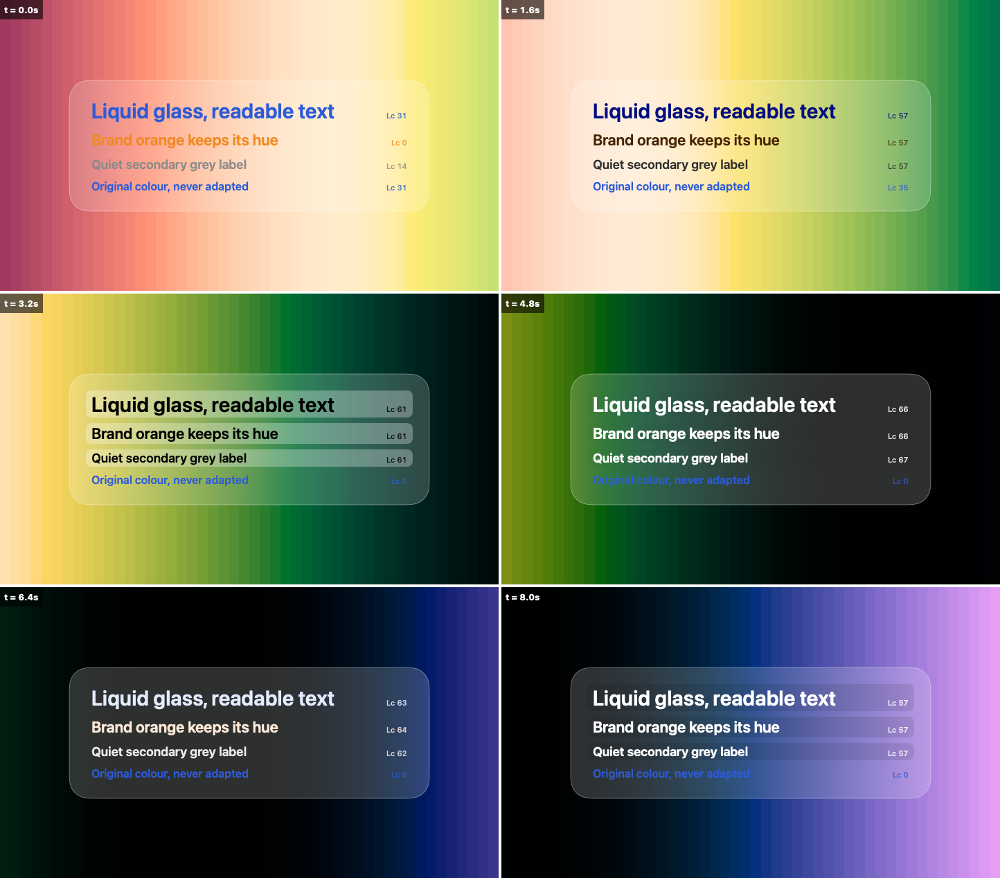

# g-l-a-s-s

A native macOS app for glassy, see-through windows **where the text stays readable**. When a
window turns translucent, whatever sits behind it (wallpaper, video, other windows) can make its text
illegible. g-l-a-s-s keeps checking what is actually behind each piece of text. It then shifts the
text toward a contrasting colour gradually, so you never see a flicker, and chooses that colour with
colour theory instead of just flipping it to black or white.



*The bottom line in each frame is the unadapted control. The `Lc` values are APCA lightness
contrast; 60 is the target. In the t = 3.2 s frame, no single colour works across that background,
so a faint veil fades in behind each line.*

## Status

Early. Nothing is released and nothing is signed.

| Part | State |
|---|---|
| `GlassContrast`: colour engine (OKLab/OKLCH, WCAG, APCA, solver, smoothing) | built, 56 tests |
| `GlassDemo`: SwiftUI glass window over a moving backdrop | built, runs |
| `GlassCaptureSpike`: overlay over *another* app's window (ScreenCaptureKit) | compiles; not yet run (needs permission) |
| Real app for "any window" | design awaiting sign-off: [`docs/DESIGN.md`](docs/DESIGN.md) |

### Why "any window" is hard

macOS doesn't let one app change another app's window opacity or text colour.

- **Real transparency** needs code injection with System Integrity Protection partly disabled, as
  yabai does it.
- **The safe route** is an overlay. It captures the window and what is behind it, then draws a glass
  version on top that lets clicks pass through. Our text colours are applied in that copy.

[`docs/DESIGN.md`](docs/DESIGN.md) covers the details, sources and trade-offs.

## How the colour engine decides

1. It samples the colours behind the text and takes the darkest and lightest backgrounds at the
   95th percentile.
2. In **OKLCH**, a perceptual colour space, it holds the text's **hue** fixed and moves only its
   lightness, as little as needed to reach the target contrast:
   - **APCA Lc 60** by default;
   - **WCAG 2 ratios** are also supported.
3. It tries both directions, lighter and darker, and keeps the smaller visible change.
4. If no colour can work, it adds the faintest black or white veil (a **scrim**) that does.
5. It eases the result in with a critically damped spring. Three kinds of hysteresis keep fast or
   noisy backgrounds from causing flicker.

## Build, test, run

Requires macOS 14+ and Swift 6 (Xcode 16+). Liquid Glass styling needs macOS 26 and Xcode 26.

```sh
swift build
swift test                                              # whole suite
swift format lint --strict --recursive Sources Tests Package.swift
swift run GlassDemo                                     # live demo window
swift run GlassDemo --snapshot demo.png                 # headless contact sheet
```

### Running the spike (needs you)

```sh
swift run GlassCaptureSpike --check     # permission status; never prompts
swift run GlassCaptureSpike --list      # needs Screen Recording
swift run GlassCaptureSpike --window Safari --alpha 0.55
```

The spike needs **Screen Recording** permission. Grant it to the terminal app that runs the binary,
in System Settings › Privacy & Security › Screen & System Audio Recording. It is a throwaway proof:
the window position is fixed at launch, and text is not yet recoloured. It only logs the colour that
default black text would need.

## Licence

MIT. See [LICENSE](LICENSE).
